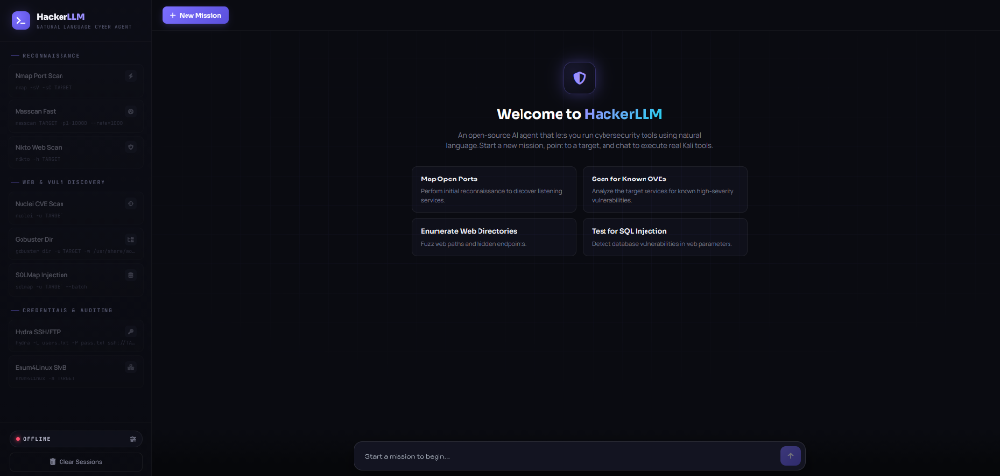

# HackerLLM ⚡

> **An AI-powered cybersecurity agent that turns natural language into real security tool execution.**

[](LICENSE)
[](https://www.python.org/downloads/)
[](Dockerfile)
[](https://www.kali.org/)

**HackerLLM** is an open-source AI agent that lets you run cybersecurity tools using natural language. Just chat with it, describe what you want to do, and it can select and execute the appropriate tools through Docker and Kali Linux runners. Bring your own AI API key and interact with your security environment without manually building every command.

<p align="center">
  
</p>

---

## ✨ Key Capabilities

- **Natural Language to Real Tool Execution:** No need to memorize obscure command-line flags. Tell HackerLLM your objective, and it structures and displays the exact CLI commands (Nmap, Nuclei, SQLMap, Gobuster, Nikto, Hydra, etc.) ready for one-click execution.
- **Human-in-the-Loop Control:** You always stay in the driver's seat. The agent proposes the tactical action; you review and trigger it with a single click.
- **Autonomous Telemetry Analysis:** Raw terminal outputs are automatically fed back to the agent to synthesize key findings, detect open ports, highlight CVEs, and outline your next attack vector.
- **Bring Your Own API (BYOAPI):** Full freedom to choose your LLM backend with zero lock-in:
  - 🦙 **Ollama:** 100% Free, local, private, and offline.
  - ⚡ **Groq Cloud:** Ultra-fast inference speeds (Free tier available).
  - ♊ **Google Gemini:** High context & free tier via Google AI Studio.
  - 🤖 **OpenAI & Compatible:** GPT-4o, DeepSeek, OpenRouter, Together AI, vLLM, LM Studio.
- **Lightweight Single-Container Setup:** Built on top of official Kali Linux rolling release. No heavyweight databases (zero Postgres, Neo4j, Redis, or Elasticsearch clusters required).
- **Embedded Dark Web Console:** Self-contained, responsive single-page web UI served directly by FastAPI.

---

## 🏗️ Architecture

```
                      +-----------------------------+
                      |   Human Operator / Web UI   |
                      |    (http://localhost:5000)   |
                      +--------------+--------------+
                                     |
               Natural Language Chat | 1-Click Tool Execution
                                     v
                      +-----------------------------+
                      |      HackerLLM Gateway      |
                      |          (FastAPI)          |
                      +--------------+--------------+
                                     |
             +-----------------------+-----------------------+
             |                                               |
             v                                               v
+-------------------------+                     +-------------------------+
|     LLM Manager         |                     |    Universal Runner     |
| (BYOAPI Provider Proxy) |                     |   (Subprocess Engine)   |
+------------+------------+                     +------------+------------+
             |                                               |
  +----------+----------+                                    v
  |          |          |                       +-------------------------+
  v          v          v                       |   Kali Linux Toolkit    |
Ollama     Gemini      Groq                     | Nmap, Nuclei, SQLMap... |
(Local)    (Free)     (Fast)                    +-------------------------+
```

---

## 🚀 Quick Start (Docker)

The fastest and most reliable way to run HackerLLM with all security tools pre-installed:

### 1. Clone the repository
```bash
git clone https://github.com/<your-username>/hackerllm.git
cd hackerllm
```

### 2. Configure your LLM Provider
Copy the template configuration file:
```bash
cp .env.example .env
```
Open `.env` and configure your preferred provider. For example, for **Google Gemini (Free tier)**:
```ini
GEMINI_API_KEY=AIzaSy...
GEMINI_MODEL=gemini-2.0-flash
```
Or for **Ollama (100% Free & Local)**:
```ini
OLLAMA_URL=http://host.docker.internal:11434
OLLAMA_MODEL=llama3.1
```

### 3. Launch the container
```bash
docker compose up --build -d
```

### 4. Open the Web Console
Navigate to [http://localhost:5000](http://localhost:5000) in your browser. Click **New Mission**, set your target, and start chatting!

---

## 💻 Local Development (Native Kali Linux)

If you are already running Kali Linux natively on bare metal or in a VM:

```bash
# 1. Clone and enter
cd hackerllm

# 2. Create virtual environment
python3 -m venv venv
source venv/bin/activate

# 3. Install requirements
pip install -r requirements.txt

# 4. Configure .env
cp .env.example .env
# Edit your .env with your favorite LLM key

# 5. Run the server
python3 app.py
```

---

## 🛠️ Included Tools & Arsenals

HackerLLM comes pre-configured with popular offensive tool categories:
- **Port Scanning & Recon:** `nmap`, `masscan`, `nikto`, `whatweb`
- **Vulnerability Scanning:** `nuclei`, `katana`, `cve-search`
- **Web Enumeration & Fuzzing:** `gobuster`, `dirb`, `ffuf`
- **Database Injection:** `sqlmap`, `commix`
- **Authentication & Auditing:** `hydra`, `enum4linux`, `smbclient`

---

## 🔒 Safety & Responsibility Disclaimer

> [!CAUTION]
> **HackerLLM is strictly designed for authorized penetration testing, security auditing, research, and educational lab environments (such as TryHackMe, HackTheBox, or personal homelabs).**
> 
> Testing against targets without prior explicit, written authorization is illegal. The creators and contributors assume no liability for misuse, damages, or violations caused by using this software.

---

## 🤝 Contributing

Contributions are warmly welcomed! Please read [CONTRIBUTING.md](CONTRIBUTING.md) for details on submitting pull requests, reporting issues, or suggesting new tool integrations.

---

## 📄 License

This project is licensed under the [MIT License](LICENSE).
